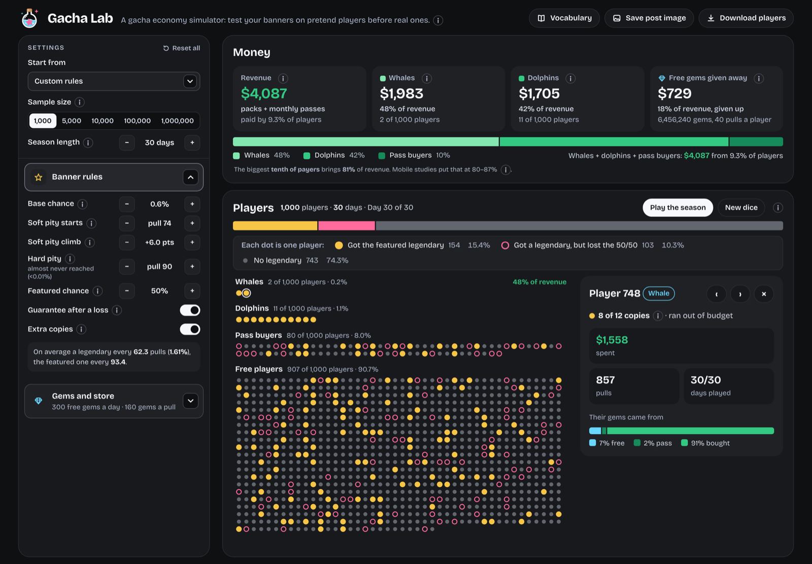
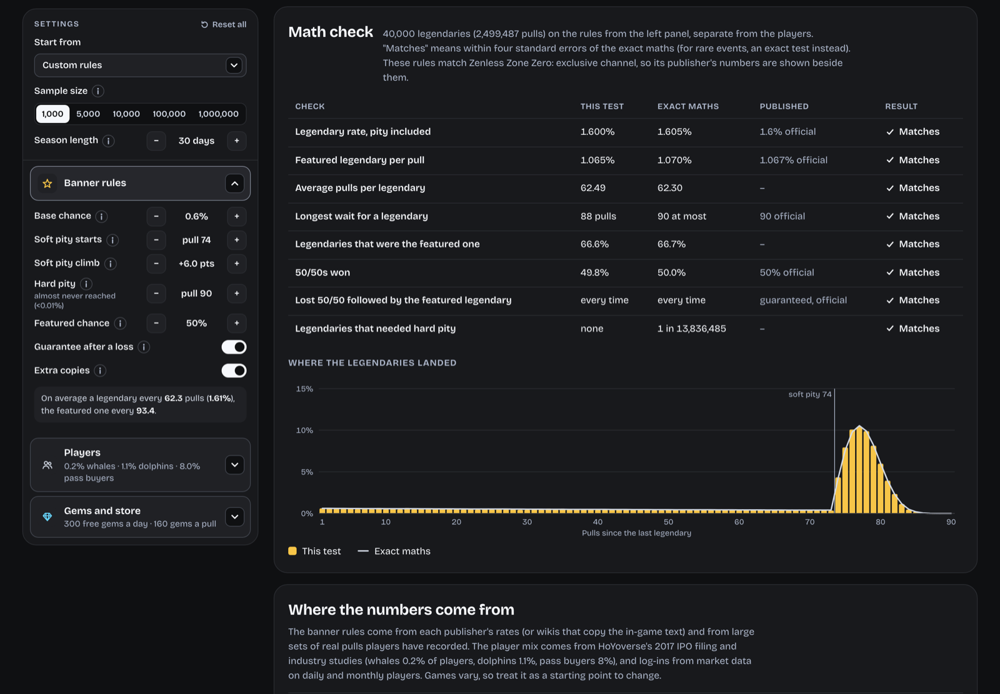

# Gacha Lab

Test a gacha economy on pretend players before real ones.

Set the banner rules, the store and the player mix, free players, pass buyers, dolphins and whales, then
watch up to 10,000 pretend players play a season: who gets the featured legendary, what it costs them,
and where the revenue comes from.

**Live: [thegachalab.pages.dev](https://thegachalab.pages.dev)**

[](https://github.com/RM-Product/Gacha-Lab/actions/workflows/test.yml)



## What it models

A season, one pull at a time, for a whole sample of players:

- **Banner rules.** Base rate, soft pity, hard pity, and the 50/50 against the featured unit, with 22 game
  presets carrying each publisher's own published numbers, plus Custom.
- **Spending.** A store, a monthly pass, and a player mix, so revenue is a result of the rules rather than
  an input to them.
- **Outcomes.** Copies won, currency spent, the pulls it took, and the spread across the sample, not just
  the average player, who is the one player the design never has to care about.

Ten presets are public. The other 13 are marked `labOnly` until someone who plays that game has checked
them, and the page says so rather than pretending otherwise. 40 sources are cited in `src/presets.js`.

## Why the maths is checkable

A simulator that can't be wrong is just an opinion with charts. This one is measured against closed-form
probability, not against itself:

```sh
npm run validate     # pulls each rule set until it has given a million 5-stars, then checks the maths
```



The run writes `docs/VALIDATION.md`: for each of the 24 rule sets, what the test measured, what the exact
maths says, and what the publisher published, side by side. A result counts as a match only if it sits
within four standard errors of the exact value, and where each 5-star landed is tested by chi-square
goodness of fit against the exact distribution, not eyeballed off a chart. `src/mathcheck.js` holds those
rows, the same comparison appears in the page under `#lab`, and runs are seeded in `src/rng.js`, so any
number on screen can be reproduced exactly.

## How it's built

No framework and no dependencies: about 4,900 lines of ES modules and 1,800 lines of tests, built into a
single page.

| File | What it is |
| --- | --- |
| `src/engine.js` | the simulation: banner rules, one player's season, and a whole sample. Pure and seeded, so it never touches the page |
| `src/mathcheck.js` | measured against exact, against published: the rows behind the maths check |
| `src/rng.js` | seeded random numbers, so a run can be repeated exactly |
| `src/presets.js` | each game's published rules, its store where it has been researched, and the sources |
| `src/suggest.js` | levers a designer controls, each tested on the same sample with the same dice as the current run |
| `src/ui/` | the page: settings on the left, the season on the right, with charts drawn as SVG at the container's real width |

## Run it

```sh
npm test             # 97 tests, node:test, no dependencies
npm run validate     # the maths check, about 5 seconds
npm run build        # dist/index.html
cd dist && python3 -m http.server 4610 --bind 127.0.0.1
```

## What it does not model

From `docs/MODEL.md`, where the assumptions are written down rather than buried: players quitting, several
banners in one season, 4-star units, weapons, first-purchase double gems, sales, and limited pack deals.
The player mix comes from one publisher's IPO filing and industry studies, so it is a starting point to
change, not a universal truth. 13 of the 23 presets are marked `labOnly` until someone who plays that game
has checked them, and the page says which. A season's revenue cannot be checked against a real banner's
takings, and the model does not claim otherwise.

## What isn't here

The anonymous page counters, the daily report worker and the deploy configuration are kept private. This
repo is the simulator and its maths, which is the part worth reading.
